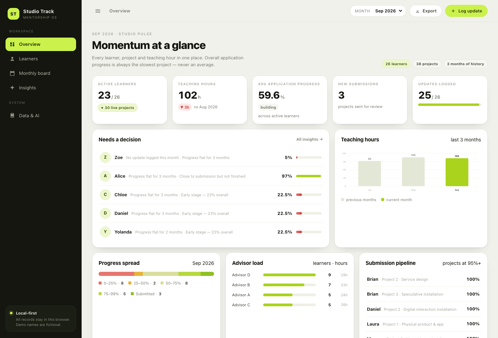

# Studio Track

**A local-first workspace for portfolio-mentorship studios.** Track every learner's projects, monthly progress, teaching hours and submission readiness — without a backend, a database or a login.

> Built as a self-contained static web app: four files of vanilla JavaScript, one JSON dataset, no build step. Drop it on GitHub Pages and it runs.

**[▶ Live demo](https://yzhu690.github.io/studio-track/)** · every learner name in the demo dataset is a placeholder (the roster is synthetic), and all edits stay in your own browser.



---

## Why this exists

Portfolio tutoring is tracked in spreadsheets. A row per project per month is fine for a single tutor, but it hides the two questions that actually matter:

1. **What is the real state of this learner's application?** Six projects at 80% is a very different situation from one project at 30%.
2. **Who did I fail to touch this month?** The silent learner is the expensive one.

Studio Track keeps the spreadsheet discipline (one record per project per month) and adds the missing layer: an explicit progress rule, a monthly board, and a briefing that tells you what to do next.

---

## The one opinionated rule

**Overall application progress = the lowest project progress in the latest month.** Never an average.

A learner's application is only as ready as its weakest portfolio piece, so averaging lets three finished projects hide one that has stalled at 20%. The rule is enforced everywhere in the app — dashboard, roster, learner record, briefing — and it is the first thing to change if your studio disagrees.

The second rule: **stalled means no movement for two consecutive months.** Not "behind schedule", not "a feeling" — a measurable silence.

---

## Features

| | |
|---|---|
| **Overview** | Live KPIs, a "needs a decision" queue ranked by an explainable score, teaching-hour trend, progress spread, advisor load, submission pipeline. |
| **Learners** | Searchable roster with advisor / cohort / package / progress filters. Sort by progress or hours. Every row opens a full record. |
| **Learner record** | Per-project progress with month-by-month history chips, cumulative hours, stage, review status, qualitative record and a one-click monthly note. |
| **Monthly board** | One row per project for the selected month, with Δ against the previous month and explicit "no update" markers. CSV export. |
| **Insights** | Deterministic findings (bottleneck project, stalled, session drop, ready to submit, strongest momentum) plus a generated studio briefing you can copy or download as Markdown. |
| **Log update** | A single modal writes progress %, hours and stage; overall progress recalculates instantly. |
| **Local-first** | All records live in `localStorage`. Export / import the whole workspace as JSON. Reset to the demo at any time. |
| **Optional AI** | Bring your own OpenAI-compatible key to rewrite the briefing or a learner note. Numbers never change — only the prose. |
| **Installable** | PWA manifest + service worker: works offline once loaded. |

### Optional AI, deliberately thin

The insight engine is **rules, not a model**: the same data always produces the same briefing, and every finding can be traced to a number. If you add an API key under *Data & AI*, the model is only used to rewrite that text in better English. If the call fails, nothing breaks — you keep the local version.

The key is stored in `localStorage` and sent directly to the endpoint you name. No proxy, no telemetry.

---

## Quick start

No build step. Any static server works.

```bash
# 1. clone
git clone https://github.com/<you>/studio-track.git
cd studio-track

# 2. serve (opening index.html directly also works, minus the service worker)
python3 -m http.server 8080

# 3. open
open http://127.0.0.1:8080
```

### Deploy

- **GitHub Pages** — Settings → Pages → *Deploy from a branch* → `main` / `/ (root)`.
- **Netlify / Vercel / Cloudflare Pages** — drag the folder in, no build command.
- **Offline** — open once, then install from the browser's address bar (PWA).

---

## Data model

Everything is one JSON object. Export it from *Data & AI → Export JSON* to see the real shape.

```jsonc
{
  "meta": { "app": "Studio Track", "months": ["2026-07", "2026-08", "2026-09"],
            "currentMonth": "2026-09", "lead": "Studio Lead" },

  "advisors": [{ "id": "A", "name": "Advisor A" }],

  "students": [{
    "id": "s01",
    "name": "Alice",                 // placeholder in the demo
    "cohort": "28F",                 // application intake
    "package": "Top 3",
    "degree": "MA",
    "countries": ["UK"],
    "major": "Interaction Design",
    "advisor": "A",
    "lastActive": "2026-09",
    "qualitative": {
      "strengths": "High finish quality…",
      "attitude": "Steady and efficient.",
      "nextFocus": "Finish final submission…"
    },
    "projects": [{
      "key": "1",
      "name": "Project 1",
      "type": "Physical installation",
      "review": { "domestic": "", "intl": "" },
      "monthly": {
        "2026-08": { "progress": 98, "hours": 3, "cumHours": 28, "stage": "Late production", "note": "" },
        "2026-09": { "progress": 97, "hours": 1, "cumHours": 29, "stage": "Final shoot & layout", "note": "" }
      }
    }]
  }],

  "settings": { "ai": { "enabled": false, "baseUrl": "https://api.openai.com/v1",
                        "model": "gpt-4o-mini", "key": "" } },
  "log": []                          // local change history
}
```

Notes:

- `monthly` is keyed `YYYY-MM`. A missing month means *nothing was logged* — the UI shows the last known value and flags it, it never invents a number.
- `progress` is 0–100 (not 0–1). `hours` is per month. `cumHours` is cumulative for that project.
- Learners without a `monthly` entry for the current month are surfaced as "no update", which is the whole point of the board.

### Using your own data

1. *Data & AI → Export JSON* to get a template.
2. Replace `students`, `advisors` and `meta.months` with your own records.
3. *Import JSON*, or overwrite `assets/js/data.js` (`window.STUDIO_SEED = {…}`) to ship it as the default.
4. If the data is real, **keep the repository private** and export a backup before clearing your browser.

---

## Project structure

```
index.html                 app shell (sidebar, topbar, mount point)
assets/css/app.css         design system + responsive rules
assets/js/data.js          the dataset (demo: anonymised)
assets/js/store.js         state, localStorage, all progress selectors
assets/js/charts.js        dependency-free SVG charts
assets/js/ai.js            rule engine + optional LLM call
assets/js/app.js           router, views, modals, exports
sw.js                      offline shell cache
manifest.webmanifest       PWA metadata
```

No frameworks, no bundler, no `node_modules`. `store.js` is the only place that computes progress, so the rule stays in one file.

---

## Privacy

The bundled dataset is **synthetic**. Learner names have been replaced with English placeholders, advisor names reduced to *Advisor A–D*, and all contact details, school names and internal links removed. Cohort labels, package tiers and progress numbers are kept because they carry the structure of the workflow without identifying anyone.

There is no analytics, no cookie, no network request except the optional AI call you configure yourself.

---

## Roadmap

- [ ] Multi-month comparison view (progress deltas per project across a term)
- [ ] Drag-to-reorder portfolio pieces per learner
- [ ] Reviewer mode: read-only link with the data embedded
- [ ] CSV / Excel import with a column mapper
- [ ] Submission calendar with deadline pressure scoring

---

## License

MIT — see [LICENSE](LICENSE).
